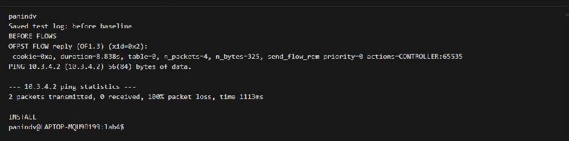
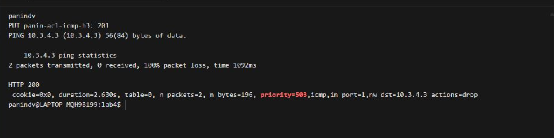
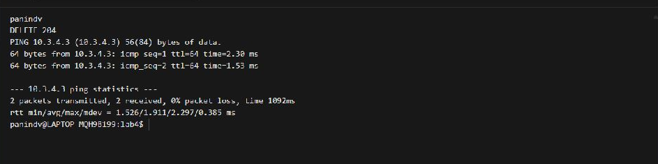
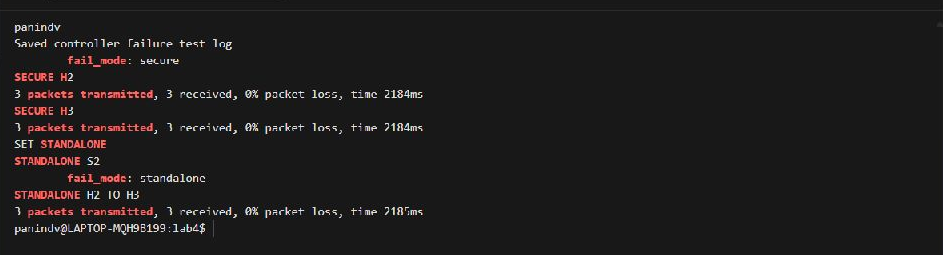
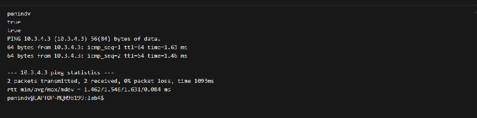

# Лабораторная работа № 4

## Настройка OpenFlow с использованием OpenDaylight и Open vSwitch

- **Дисциплина:** Виртуализация сетевых функций
- **Университет:** ИТМО, факультет ФПИН
- **Группа:** K3420
- **Выполнил:** Панин Дмитрий Владимирович
- **Руководитель:** Аминов Н.С.

## Цель работы

Развернуть контроллер OpenDaylight и два коммутатора Open vSwitch, подключить их по OpenFlow 1.3 и проверить, как правила потоков влияют на передачу трафика.

## Топология и адресация

Стенд развернут в WSL2 с помощью Docker и Containerlab. Коммутаторы работают на Open vSwitch в контейнерах Linux. Контроллер и коммутаторы обмениваются данными по отдельной сети управления.

```text
h1 - s1 - s2 - h2
           |
           h3
ODL - сеть управления - s1 и s2
```

| Узел | Адрес или назначение |
| --- | --- |
| ODL | `10.104.3.100`, OpenFlow `6653`, RESTCONF `8181` |
| s1 | порт 1 - h1, порт 2 - s2 |
| s2 | порт 1 - h2, порт 2 - s1, порт 3 - h3 |
| h1 | `10.3.4.1/24` |
| h2 | `10.3.4.2/24` |
| h3 | `10.3.4.3/24` |

## Настройка контроллера и коммутаторов

В OpenDaylight установлены компоненты OpenFlow и RESTCONF. На каждом коммутаторе создан мост `br0`, включен OpenFlow 1.3 и указан адрес контроллера. Проверка показала подключение обеих сессий; в инвентаре ODL были узлы `openflow:1` и `openflow:2`. RESTCONF использовал HTTP на порту 8181.

## Базовые потоки

До установки базовых правил на s1 оставалось правило table-miss с передачей пакетов контроллеру. Ping h1 к h2 не прошел: 0 ответов из 2.



*Рисунок 1 - Журнал проверки до установки правил.*

Через RESTCONF отправлены восемь базовых правил. После установки ping h1 к h3 дал 3 ответа из 3. Первая проверка h1 к h2 дала 2 ответа из 3, повторная - 3 из 3. Причина потери первого пакета точно не установлена; возможно, она связана с разрешением адреса.

## Проверка ACL

На s1 установлено правило с приоритетом 503, блокирующее ICMP от h1 к h3. В основной проверке ping к h3 не прошел, HTTP вернул 200, а ping к h2 дал 2 ответа из 2. Счетчик правила показал 3 пакета и 294 байта. На рисунке приведена отдельная повторная проверка: счетчик показал 2 пакета и 196 байт.



*Рисунок 2 - Проверка блокировки ICMP, HTTP и счетчика ACL.*

После удаления ACL контроллер вернул код 204, а ping h1 к h3 снова прошел - 2 ответа из 2.



*Рисунок 3 - Удаление ACL и восстановление связи.*

## Проверка при отказе контроллера

При остановленном ODL в режиме `secure` соединение с контроллером отсутствовало, но ранее установленные правила позволили получить по 3 ответа из 3 от h2 и h3. Затем на s2 включили режим `standalone`. Через 35 секунд таблица потоков s2 была пуста, а ping h2 к h3 дал 3 ответа из 3 за счет обычной коммутации OVS.



*Рисунок 4 - Журнал проверки при отключенном контроллере.*

После возвращения s2 в `secure` и запуска ODL ранняя попытка отправки правил получила ответ 404. После подключения обеих сессий и появления узлов в инвентаре базовые потоки отправили повторно. Автоматическое восстановление всех правил до повторной отправки не подтверждено.



*Рисунок 5 - Результаты проверки соединения и ping после восстановления стенда.*

## Результат

В лабораторной работе два коммутатора OVS подключены к OpenDaylight по OpenFlow 1.3. Проверены передача трафика по установленным правилам, блокировка ICMP с помощью ACL и работа сети при остановке контроллера. После восстановления контроллера правила были отправлены повторно.
